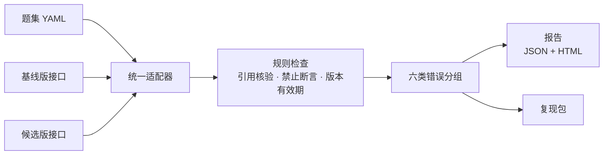

<div align="center">

# 🧪 RAG 回归评测与错误归因系统

**同一套题集，跑两版问答系统，一眼看出哪些答案进步、退化、错引用或越权。**

[](#环境要求)
[](LICENSE)
[](#测试)
[](#快速开始)

</div>

---

## 这是什么

一个**本地可复跑的 RAG 回归评测工具**，服务对象是维护企业知识问答的产品、实施与研发人员。

日常最头疼的不是「没有一个综合分」，而是**一次改动之后，不知道哪个门店、哪个车型、哪类问题受影响**，也很难把错误交给对应的人修复。这个工具把「我会评测」变成可运行的证据：

| 你的日常困难 | 这个工具给你 |
|---|---|
| 改了知识库 / 检索 / 提示词，不知道影响面 | 同题集跑**基线版 vs 候选版**，逐题标出**进步 / 退化 / 持平** |
| 答案引用错了来源、串了企业、用了过期政策 | 规则检查按**六类错误**定位到**题目 + 引用证据** |
| 想复现某个失败答案 | 失败项一键导出**复现包**（原题、原答、引用、版本） |
| 自动评分不敢全信 | **人工标注与自动结果分开显示**，可回放评分依据 |

## 快速开始

```bash
git clone https://github.com/lizilong0326/rag-eval.git
cd rag-eval

./demo.sh
```

跑完自动在浏览器打开报告：基线版 20 题全过，候选版被注入四类错误后，**Q01 / Q04 / Q12 / Q15** 会被精确定位并给出证据。

> **环境要求**：Python 3.10+。`demo.sh` 会自动安装唯一运行时依赖 `pyyaml`。
> 演示走进程内 mock，**零模型调用、零费用**，无需任何 API Key。

## 四类错误注入（验收口径）

| 注入错误 | 报告分组 | 演示题目 | 定位证据 |
|---|---|---|---|
| 无来源补写 | 🔵 模型补写 | Q01 | `no_citation` |
| 接口超时 | ⚫ 接口失败 | Q04 | `endpoint_error`（真实 HTTP 超时 + 重试 1 次） |
| 过期政策 | 🟣 过期资料 | Q12 | `citation_expired` |
| 跨企业引用 | 🔴 越权 | Q15 | `citation_wrong_enterprise` |

## 工作原理



六类错误分组（优先级从高到低）：

| 分组 | 含义 |
|---|---|
| 接口失败 | 超时 / 5xx / 4xx / 连接拒绝 / 返回体异常 |
| 越权 | 引用了**其他企业**的文档 |
| 过期资料 | 引用了**超出有效期窗口**的版本 |
| 错引用 | 引用文档**不存在**或内容不支撑答案 |
| 模型补写 | 有答案但**无引用来源**，或说出禁止断言 |
| 未命中 | 未覆盖期望要点 |

> 关键边界：**引用 ID 若被测接口不返回，只能标注「无法核验」，不能算通过。**

## 报告

- **`report.json`** —— 机器可读，含逐题结果、错误分组、回归差异；
- **`report.html`** —— 可阅读页面（macOS 风格，支持深色模式），按错误类型分组展示原题 / 原答 / 引用证据；
- **`repro/<版本>/<题目>.json`** —— 失败项复现包。

## 项目结构

```
rag-eval/
├── rag_eval/                # 核心包
│   ├── models.py            #   数据模型（题集 / 企业版本 / 引用 / 结果）
│   ├── rules.py             #   确定性规则检查与错误分组
│   ├── adapter.py           #   HttpAdapter / MockAdapter（超时 5s，仅超时与 5xx 重试 1 次）
│   ├── permission.py        #   被测接口白名单校验（默认拒绝 + 审计日志）
│   ├── redact.py            #   敏感输入脱敏（手机号 / 邮箱 / 身份证）
│   ├── mock_system.py       #   自建 mock 被测系统（可注入四类错误）
│   ├── serve_mock.py        #   本地 HTTP mock 服务
│   ├── semantic.py          #   语义评分（辅助，可选，默认关闭）
│   ├── promptfoo.py         #   promptfoo 断言导出
│   ├── report.py            #   报告生成（JSON + HTML）
│   ├── repro.py             #   失败项复现包
│   └── cli.py               #   命令行入口
├── data/                    # 全部合成数据：企业版本 / 语料 / 20 题题集
├── tests/                   # 12 个测试（核心循环 + 四类注入错误固定样例）
├── docs/prd.md              # 产品需求文档（含已确认决策）
├── demo.sh                  # 一键演示（进程内 mock）
├── http_demo.sh             # 真实 HTTP 链路演示（起两个 mock 服务）
└── config.example.yaml      # 真实接口契约示例
```

## 评测数据来源

`data/` 下全部为**合成数据**（虚构品牌「示例房车」「同行品牌」），不含真实客户、门店或人员信息。演示中的手机号 `13800138000` 为占位号，会被脱敏规则替换，用于演示脱敏能力。

## 适用范围与误判边界

**适用范围**

- 首版支持一个 HTTP 被测接口 + 进程内 mock；
- 规则检查覆盖：引用是否存在、来源是否属于当前企业、版本是否在有效期、是否说出禁止断言、是否承认资料不足。

**误判边界（重要）**

- 「错引用」的内容支撑判定是轻量字符覆盖率，**不构成事实正确性结论**；
- 自动结果 = 确定性规则，**不宣称等于事实正确**，需人工抽样复核（≥ 20%，每个错误分组至少 1 题）；
- 一致率 / 准确率等指标须完成实测后再写，当前不承诺具体数值。

## 接入真实接口

被测接口契约（HTTP POST + Bearer 鉴权）：

```jsonc
// 请求体
{"question_id": "Q01", "question": "...", "enterprise_id": "...", "version": "..."}

// 响应体
{
  "answer": "...",
  "citations": [{"doc_id": "...", "enterprise_id": "...", "version": "..."}],
  "model_version": "...",
  "knowledge_version": "...",
  "latency_ms": 0
}
```

```bash
python -m rag_eval run \
  --dataset data/dataset.yaml --corpus data/corpus.yaml --enterprises data/enterprises.yaml \
  --url http://127.0.0.1:8000/ask --token "$QA_ENDPOINT_TOKEN" \
  --allow-hosts 127.0.0.1,localhost \
  --candidate-url http://127.0.0.1:8001/ask \
  -o out/run
```

- 两版回归：`--url`（基线）+ `--candidate-url`（候选）；
- 人工标注：`--annotations annotations.yaml`（`{annotations: {Q01: "文本"}}`）；
- 语义评分（可选）：加 `--semantic` 走 DeepSeek，结果**不参与**规则分组；
- promptfoo 断言导出：`python -m rag_eval export-promptfoo --dataset data/dataset.yaml --url <接口> -o out/promptfooconfig.yaml`。

## 测试

```bash
python -m pytest tests/ -q
```

覆盖：核心循环回归（导入 → 调用 → 规则检查 → 报告）、四类注入错误的固定失败样例、语义评分降级、promptfoo 导出、重复运行一致性。

## License

[MIT](LICENSE) © 2026 lizilong0326
